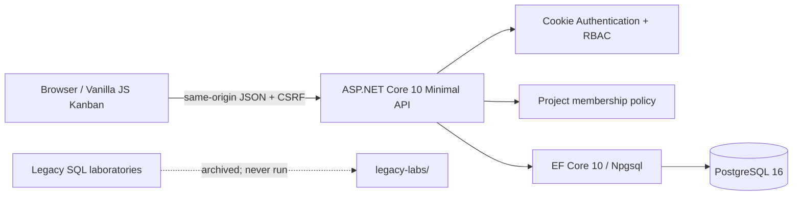

<div align="center">

# 🎮 PADO StudioOps

### Game Development Studio Management Platform

**Production tracking · Team access · PostgreSQL-backed Kanban**

   

[](https://github.com/PADOALEX/PADO-StudioOps/actions/workflows/ci.yml)

*A studio management application built from a PostgreSQL game-development domain model and a custom vanilla-JavaScript Task Board.*

</div>

---

## What is StudioOps?

PADO StudioOps is a compact internal production workspace for teams making games. A studio administrator creates studios, employees, projects and login accounts. Project managers organize milestones, team memberships, builds and tickets. Developers see only projects they belong to and can update their own assigned tickets.

All board changes are persisted through an ASP.NET Core 10 API to PostgreSQL. **No task data is stored in `localStorage`.** The frontend intentionally retains and adapts the original HTML/CSS/JavaScript Task Board; React would add complexity without benefit for this scope.

### Key capabilities

- **Studios and people:** administrator-level CRUD for studios and employees.
- **Projects:** project lifecycle/status, genre, lead, budget, start and expected release dates.
- **Milestones:** CRUD with planned dates and production statuses.
- **Kanban:** create, edit, delete and drag tickets between **To Do**, **In Progress** and **Done**.
- **Detailed workflow:** the database retains **Code Review** and **Testing**, grouped under In Progress in the three-column board.
- **Ticket planning:** assignees, priorities, estimates, due dates, search, filters and sorting.
- **Overview:** completed vs total tickets, completion percentage, open milestones, latest game builds.
- **Secure access:** Admin / ProjectManager / Developer, project membership checks on every project-scoped endpoint, HttpOnly SameSite cookies, anti-CSRF header, hashed passwords, login rate limiting.
- **Data integrity:** foreign keys, unique indexes, CHECK constraints, optimistic task revision checks.
- **Dev experience:** isolated EF Core migration, optional controlled seed, Docker Compose and GitHub Actions CI.

## Architecture



### Project layout

```text
PADO-StudioOps/
├── src/PADO.StudioOps.Api/
│   ├── Domain/                 # 11 entities and workflow constants
│   ├── Data/                   # EF Core model, controlled migrations
│   ├── Endpoints/              # auth, admin, projects, milestones, tickets
│   ├── Security/               # project checks and problem handling
│   ├── Services/               # explicitly opted-in demo bootstrap
│   └── wwwroot/                # Task Board UI + API client
├── tests/
│   ├── PADO.StudioOps.UnitTests/
│   └── PADO.StudioOps.IntegrationTests/
├── docs/                       # audit, mapping, security, verification
├── legacy-labs/                # archived original SQL scripts; unsafe to execute
├── compose.yml
├── compose.dev.yml
├── Dockerfile
├── .github/workflows/ci.yml
└── PADO.StudioOps.slnx
```

## Quick start — Docker (recommended)

**Requires** Docker Engine/Desktop and Docker Compose V2. This demo starts an isolated PostgreSQL container, migrates **only** the StudioOps EF schema and provisions a demonstration workspace.

```bash
# 1. Clone your repo (or open the extracted project folder)
cp .env.example .env       # Windows PowerShell: Copy-Item .env.example .env
# 2. Edit .env: change POSTGRES_PASSWORD and STUDIOOPS_ADMIN_PASSWORD
#    STUDIOOPS_ADMIN_PASSWORD must be >=12 characters.
docker compose up --build -d
# 3. Open http://localhost:8080
```

Use `STUDIOOPS_ADMIN_EMAIL` and `STUDIOOPS_ADMIN_PASSWORD` from **your local `.env`** to log in. Credentials are not embedded in code, seed files or README.

```bash
docker compose ps
docker compose logs -f api
docker compose down            # stop; preserve PostgreSQL volume
docker compose down -v         # DANGER: deletes the StudioOps demo DB volume
```

### Run from .NET 10 SDK on Windows / locally

Start PostgreSQL using the supplied dev override (`5435` host port). You need Docker for this alternative too, unless you have PostgreSQL installed locally.

```powershell
Copy-Item .env.example .env
# Edit passwords in .env
docker compose -f compose.yml -f compose.dev.yml up -d db
# Configure environment or use dotnet user-secrets for the connection string:
$env:ConnectionStrings__StudioOps = 'Host=localhost;Port=5435;Database=studioops;Username=studioops;Password=<your-postgres-password>'
$env:STUDIOOPS_AUTO_MIGRATE = 'true'
$env:STUDIOOPS_BOOTSTRAP_ADMIN = 'true'
$env:STUDIOOPS_DEMO_SEED = 'true'
$env:STUDIOOPS_ADMIN_EMAIL = 'admin@studioops.local'
$env:STUDIOOPS_ADMIN_PASSWORD = '<your-12+-character-admin-password>'
dotnet restore PADO.StudioOps.slnx
dotnet run --project src/PADO.StudioOps.Api --urls http://localhost:5080
# Open http://localhost:5080
```

> `.env` values are consumed automatically by Docker Compose only, not by `dotnet run` in PowerShell; the environment variables shown above are necessary. **Never commit `.env` or real secrets.**

## Authorization matrix

| Action | Admin | Project Manager | Developer |
|---|:---:|:---:|:---:|
| Manage studios and employee HR fields | ✅ | ❌ | ❌ |
| Create/delete game projects and provision users | ✅ | ❌ | ❌ |
| Read a project | All | Member only | Member only |
| Update project/milestones/membership | ✅ | Member only | ❌ |
| Record new game build | ✅ | Member only | ❌ |
| Create tasks | ✅ | Member only | Self-assigned in a member project |
| Update/move a task | ✅ | Member only | Own assigned task only |
| Delete tasks | ✅ | Member only | ❌ |

A user **cannot** self-register or select their own role. The Admin creates accounts through `/api/admin/users`. A project membership is mandatory for managers and developers to access non-admin project data. A task's assignee must already belong to the project. HR salaries are exposed **only** via administrator employee endpoints.

## API routes

| Resource | Endpoints |
|---|---|
| Auth | `GET /api/auth/csrf`, `POST /api/auth/login`, `POST /api/auth/logout`, `GET /api/auth/me` |
| Studios | `GET, POST /api/studios`; `GET, PUT, DELETE /api/studios/{id}` |
| Employees | `GET, POST /api/employees`; `GET, PUT, DELETE /api/employees/{id}` |
| Admin | `POST /api/admin/users` |
| Projects | `GET, POST /api/projects`; `GET, PUT, DELETE /api/projects/{projectId}` |
| Project access | `GET, POST /api/projects/{projectId}/members`; `DELETE .../members/{employeeId}` |
| Milestones | `GET, POST /api/projects/{projectId}/milestones`; `PUT, DELETE .../milestones/{id}` |
| Tasks | `GET, POST /api/projects/{projectId}/tasks`; `GET, PUT, DELETE .../tasks/{id}` |
| Ticket state | `PATCH /api/projects/{projectId}/tasks/{id}/status` |
| Progress | `GET /api/projects/{projectId}/overview`; `POST .../builds` |
| Health | `GET /health`, `GET /health/ready` |

**Task query filters:** `search`, `priority`, `status`, `assigneeId`, `sort=recent|oldest|title|priority|deadline`. Task updates/moves include the last known integer `revision` to reject stale concurrent writes (`409 Conflict`). The task list is bounded at 500 records/project per request for this initial release; pagination is a future improvement.

For development, OpenAPI JSON is available at `/openapi/v1.json` when `ASPNETCORE_ENVIRONMENT=Development`. No Swagger UI dependency is required.

## PostgreSQL model and migrations

Ten core domain tables come from the original `DB_Task.zip`: `studios`, `employees`, `employee_profiles`, `game_projects`, `milestones`, `tasks`, `technologies`, `game_builds`, `project_members`, `project_technologies`. A separate `app_users` table was added for authentication.

The `tasks` table gains `description`, `due_date`, `created_at`, `updated_at`, `revision`. Realistic seed data is separate from the legacy `generate_series` laboratory seed. Original referential actions (`CASCADE`, `SET NULL`, `RESTRICT`), status/priority checks and money/estimate checks are preserved or adapted.

**IMPORTANT:** The original `DB_Task.zip` opens with `DROP SCHEMA IF EXISTS public CASCADE` and contains deliberately failing transaction tests. It is archived under `legacy-labs/` and NEVER invoked by runtime, migrations, Docker or CI. StudioOps migrations operate on application tables only; `Down()` drops only the tables managed by that migration. Do not apply the historical scripts to the StudioOps database.

To apply migrations explicitly, install EF tools and run `dotnet ef database update --project src/PADO.StudioOps.Api`. In Docker demo mode `STUDIOOPS_AUTO_MIGRATE=true` opts into controlled EF migration at application startup. In a real production environment, apply reviewed migrations as a separate deployment step and leave auto-migrate disabled.

## Tests and quality gates

```bash
dotnet restore PADO.StudioOps.slnx
dotnet build PADO.StudioOps.slnx -c Release
dotnet test tests/PADO.StudioOps.UnitTests -c Release
# Integration tests require a disposable PostgreSQL test database:
# set STUDIOOPS_TEST_DB="Host=localhost;Port=...;Database=studioops_test;..."
dotnet test tests/PADO.StudioOps.IntegrationTests -c Release
node --check src/PADO.StudioOps.Api/wwwroot/js/board.js
```

CI provisions a PostgreSQL 16 service and runs both test suites. The integration scenario tests anonymous denial, CSRF rejection, login, project creation, milestone creation, ticket persistence, status move, revision conflict, progress aggregation and developer project isolation. See `docs/VERIFICATION.md` for which checks have **actually** been run and what still requires SDK/Docker/GitHub Actions.

For HTTPS deployments, configure `STUDIOOPS_COOKIE_SECURE=true` and serve the app through a trusted TLS reverse proxy. The local Docker HTTP demo intentionally uses request-dependent cookie security; it is **not** a hardened public deployment.

## Screenshots / demo

For a truthful portfolio screenshot, run the Docker demo and capture the board, project overview and milestones **from the actual running application**. Real screenshots are intentionally not fabricated in this repository.

## Roadmap

- Task pagination and server-backed full-text search for large projects
- Audit log for administrative changes and release history
- Structured RBAC permission management and invitation/onboarding flows
- Project resource forecasting and burndown reports
- Reverse-proxy HTTPS deployment, secrets manager and database backups

---

**PADO GameDevelopment Studio** · Portfolio case study: relational modeling, secure APIs, production workflow, frontend integration, Docker, automated testing.
